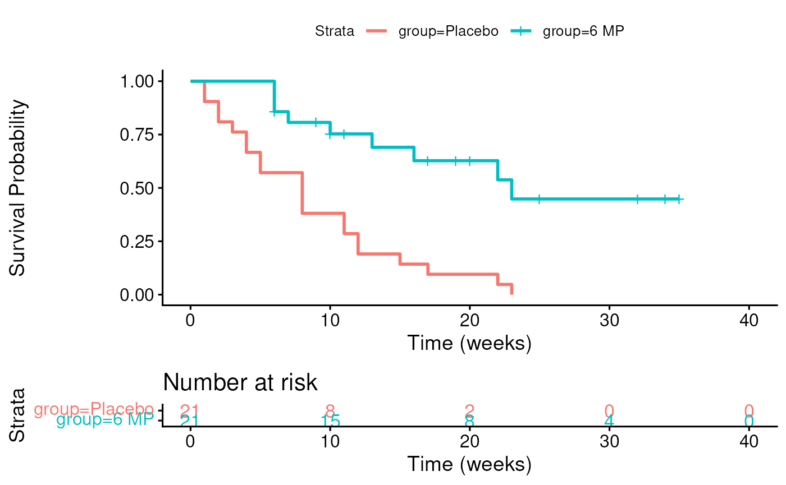
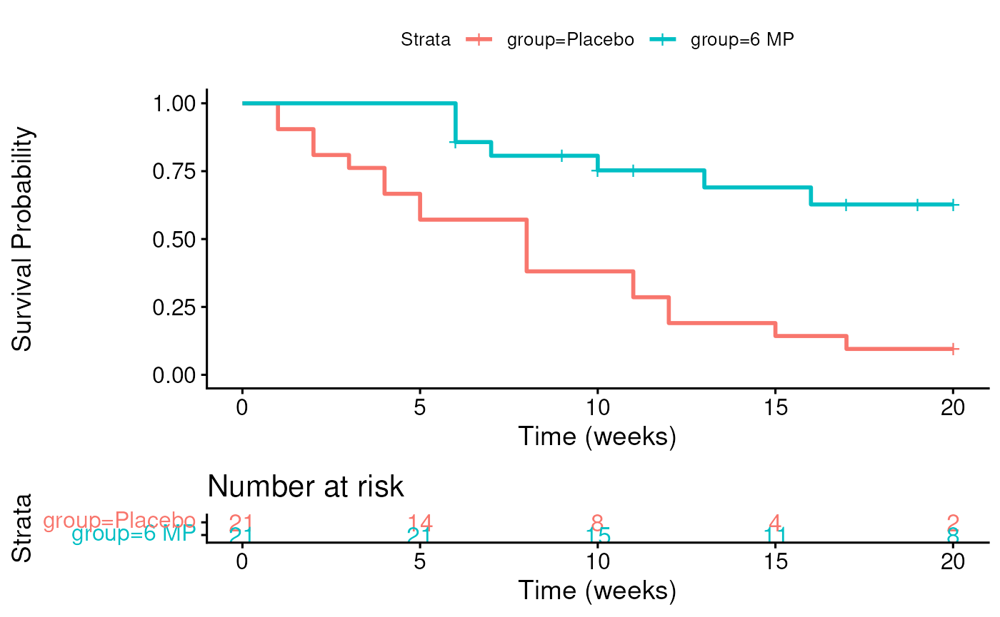

# Session 6 lab exercise: Survival Analysis part 1

**Learning objectives**

1.  Calculate Kaplan-Meier estimates of survival probability over time
2.  Plot survival curves for censored time-to-event data
3.  Perform and interpret log-rank test
4.  Define “informative” censoring

## Load the leukemia 6 MP clinical trial dataset

In this dataset, `time` is weeks until relapse or censoring, and `cens`
is the event indicator: 1 if the patient relapsed and 0 if they were
censored. Despite its name, `cens = 1` means an *event*, not a censored
observation. We set Placebo as the reference group.

\
[`library`](https://rdrr.io/r/base/library.html)`(`[`tidyverse`](https://tidyverse.tidyverse.org)`)`\
[`library`](https://rdrr.io/r/base/library.html)`(`[`survival`](https://github.com/therneau/survival)`)`\
[`library`](https://rdrr.io/r/base/library.html)`(`[`survminer`](https://rpkgs.datanovia.com/survminer/index.html)`)`\
`leuk`` ``<-`` `[`read_csv`](https://readr.tidyverse.org/reference/read_delim.html)`(``"leuk.csv"``)`` `[`%>%`](https://magrittr.tidyverse.org/reference/pipe.html)\
`  `[`mutate`](https://dplyr.tidyverse.org/reference/mutate.html)`(``group ``=`` `[`factor`](https://rdrr.io/r/base/factor.html)`(``group``, levels ``=`` `[`c`](https://rdrr.io/r/base/c.html)`(``"Placebo"``, ``"6 MP"``)``)``)`\
[`table`](https://rdrr.io/r/base/table.html)`(``leuk``$``group``, ``leuk``$``cens``)`

    ##          
    ##            0  1
    ##   Placebo  0 21
    ##   6 MP    12  9

[`Surv()`](https://rdrr.io/pkg/survival/man/Surv.html) combines time and
event status into a single outcome. Censored times are printed with a
`+`:

\
[`with`](https://rdrr.io/r/base/with.html)`(``leuk``, `[`Surv`](https://rdrr.io/pkg/survival/man/Surv.html)`(``time``, ``cens``)``)`

    ##  [1]  6   6   6   7  10  13  16  22  23   6+  9+ 10+ 11+ 17+ 19+ 20+ 25+ 32+ 32+
    ## [20] 34+ 35+  1   1   2   2   3   4   4   5   5   8   8   8   8  11  11  12  12 
    ## [39] 15  17  22  23

## Calculate the follow-up table for 6 MP patients

[`summary()`](https://rdrr.io/r/base/summary.html) of a `survfit` object
gives the follow-up table: at each event time, the number at risk, the
number of events, and the Kaplan-Meier estimate of survival with its 95%
confidence interval. Compare this to the follow-up table in the lecture.

\
`fit6mp`` ``<-`` `[`survfit`](https://rdrr.io/pkg/survival/man/survfit.html)`(`[`Surv`](https://rdrr.io/pkg/survival/man/Surv.html)`(``time``, ``cens``)`` ``~`` ``1``, data ``=`` `[`filter`](https://dplyr.tidyverse.org/reference/filter.html)`(``leuk``, ``group`` ``==`` ``"6 MP"``)``)`\
[`summary`](https://rdrr.io/r/base/summary.html)`(``fit6mp``)`

    ## Call: survfit(formula = Surv(time, cens) ~ 1, data = filter(leuk, group == 
    ##     "6 MP"))
    ## 
    ##  time n.risk n.event survival std.err lower 95% CI upper 95% CI
    ##     6     21       3    0.857  0.0764        0.720        1.000
    ##     7     17       1    0.807  0.0869        0.653        0.996
    ##    10     15       1    0.753  0.0963        0.586        0.968
    ##    13     12       1    0.690  0.1068        0.510        0.935
    ##    16     11       1    0.627  0.1141        0.439        0.896
    ##    22      7       1    0.538  0.1282        0.337        0.858
    ##    23      6       1    0.448  0.1346        0.249        0.807

## Plot the Kaplan-Meier estimate for both groups

\
`fit`` ``<-`` ``survminer``::`[`surv_fit`](https://rdrr.io/pkg/survminer/man/surv_fit.html)`(`[`Surv`](https://rdrr.io/pkg/survival/man/Surv.html)`(``time``, ``cens``)`` ``~`` ``group``, data ``=`` ``leuk``)`\
`survminer``::`[`ggsurvplot`](https://rdrr.io/pkg/survminer/man/ggsurvplot.html)`(``fit``,`\
`           xlab ``=`` ``"Time (weeks)"``,`\
`           ylab ``=`` ``"Survival Probability"``,`\
`           risk.table ``=`` ``TRUE``, risk.table.col ``=`` ``"strata"``)`

## What is the time by which 25% of patients in each group have relapsed?

This is the time at which the estimated survival probability drops to
75%. [`quantile()`](https://rdrr.io/r/stats/quantile.html) of a
`survfit` object returns quantiles of the *event time* distribution, so
this is the `25` column: the time by which 25% of patients have had an
event, and 75% are still event-free.

\
[`quantile`](https://rdrr.io/r/stats/quantile.html)`(``fit``)`

    ## $quantile
    ##               25 50 75
    ## group=Placebo  4  8 12
    ## group=6 MP    13 23 NA
    ## 
    ## $lower
    ##               25 50 75
    ## group=Placebo  2  4  8
    ## group=6 MP     6 16 23
    ## 
    ## $upper
    ##               25 50 75
    ## group=Placebo  8 12 NA
    ## group=6 MP    NA NA NA

25% of 6 MP patients had relapsed by 13 weeks, compared to 4 weeks for
Placebo patients. The `75` column is `NA` for the 6 MP group because the
Kaplan-Meier estimate never drops below 25% survival before follow-up
ends.

## Perform a log-rank test comparing the two groups

\
[`survdiff`](https://rdrr.io/pkg/survival/man/survdiff.html)`(`[`Surv`](https://rdrr.io/pkg/survival/man/Surv.html)`(``time``, ``cens``)`` ``~`` ``group``, data ``=`` ``leuk``)`

    ## Call:
    ## survdiff(formula = Surv(time, cens) ~ group, data = leuk)
    ## 
    ##                N Observed Expected (O-E)^2/E (O-E)^2/V
    ## group=Placebo 21       21     10.7      9.77      16.8
    ## group=6 MP    21        9     19.3      5.46      16.8
    ## 
    ##  Chisq= 16.8  on 1 degrees of freedom, p= 4e-05

## Cap follow-up times at 20 weeks

Suppose you were instructed to cap follow-up times at 20 weeks. Anyone
still event-free at 20 weeks becomes censored at 20 weeks, and events
after 20 weeks are no longer counted.

\
`leuknew`` ``<-`` ``leuk`` `[`%>%`](https://magrittr.tidyverse.org/reference/pipe.html)\
`  `[`mutate`](https://dplyr.tidyverse.org/reference/mutate.html)`(``newtime ``=`` `[`pmin`](https://rdrr.io/r/base/Extremes.html)`(``time``, ``20``)``)`` `[`%>%`](https://magrittr.tidyverse.org/reference/pipe.html)\
`  `[`mutate`](https://dplyr.tidyverse.org/reference/mutate.html)`(``newcens ``=`` `[`ifelse`](https://rdrr.io/r/base/ifelse.html)`(``time`` ``<=`` ``20``, ``cens``, ``0``)``)`

Kaplan-Meier plot:

\
`fit20`` ``<-`` ``survminer``::`[`surv_fit`](https://rdrr.io/pkg/survminer/man/surv_fit.html)`(`[`Surv`](https://rdrr.io/pkg/survival/man/Surv.html)`(``newtime``, ``newcens``)`` ``~`` ``group``, data ``=`` ``leuknew``)`\
`survminer``::`[`ggsurvplot`](https://rdrr.io/pkg/survminer/man/ggsurvplot.html)`(``fit20``,`\
`           xlab ``=`` ``"Time (weeks)"``,`\
`           ylab ``=`` ``"Survival Probability"``,`\
`           risk.table ``=`` ``TRUE``, risk.table.col ``=`` ``"strata"``)`

Log-rank test:

\
[`survdiff`](https://rdrr.io/pkg/survival/man/survdiff.html)`(`[`Surv`](https://rdrr.io/pkg/survival/man/Surv.html)`(``newtime``, ``newcens``)`` ``~`` ``group``, data ``=`` ``leuknew``)`

    ## Call:
    ## survdiff(formula = Surv(newtime, newcens) ~ group, data = leuknew)
    ## 
    ##                N Observed Expected (O-E)^2/E (O-E)^2/V
    ## group=Placebo 21       19       10      8.05        14
    ## group=6 MP    21        7       16      5.05        14
    ## 
    ##  Chisq= 14  on 1 degrees of freedom, p= 2e-04

## Give a hypothetical example of how censoring in this example might be “informative.”

If sicker patients were moved to another hospital where they weren’t
followed up on, and were also more likely to relapse, this would be
informative censoring.

## Exercises

### Exercise 1: Median survival and median potential follow-up time

Using the uncapped data, find the median survival time and its 95%
confidence interval for each group by printing `fit`. Then estimate the
median *potential* follow-up time for each group using the reverse
Kaplan-Meier method from the lecture, where censoring is treated as the
“event”: `survfit(Surv(time, 1 - cens) ~ group, data = leuk)`. Why is
the median potential follow-up time `NA` for the Placebo group? Is there
any reason to believe potential follow-up differed between the two arms
of this trial?

### Exercise 2: Cumulative event function

Plot the cumulative event function $`1 - S(t)`$ for both groups by
adding `fun = "event"` to
[`ggsurvplot()`](https://rdrr.io/pkg/survminer/man/ggsurvplot.html).
Using `summary(fit, times = 10)`, estimate the proportion of patients in
each group who had relapsed by 10 weeks.

### Exercise 3: Effect of capping follow-up

Compare the log-rank test from the uncapped data to the one capped at 20
weeks. How did the observed and expected numbers of events, and the
chi-square statistic, change? Explain why capping follow-up changed the
result, even though the Kaplan-Meier curves before 20 weeks are
identical.
