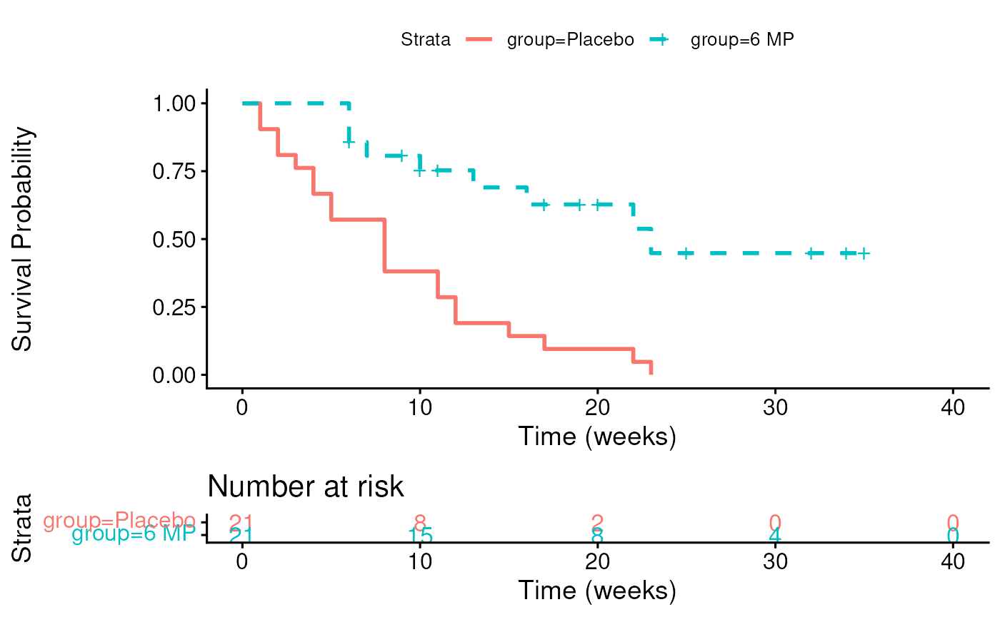
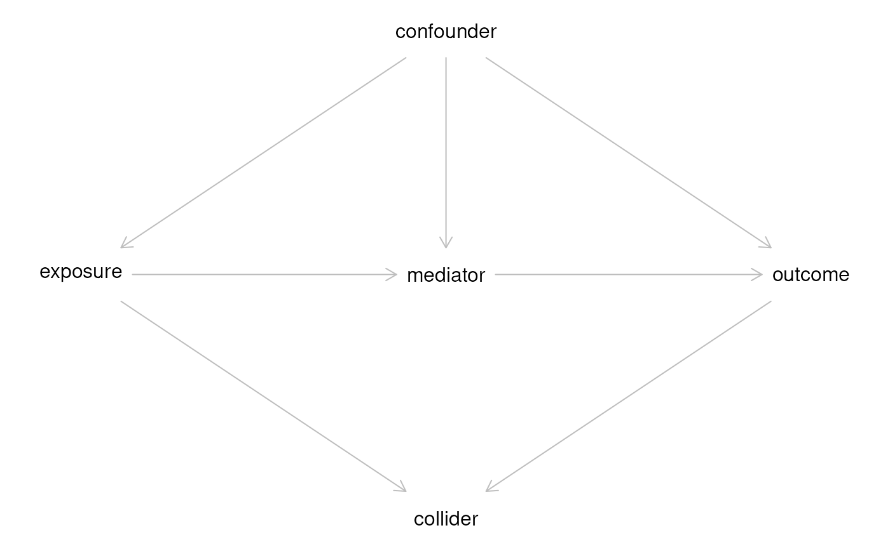

# Session 7 lab exercise: Cox proportional hazards

**Learning objectives**

1.  Fit a Cox proportional hazard model
2.  Create a stratified Kaplan-Meier plot
3.  Fit exponential and Weibull accelerated failure time models
4.  Fit a model using strata and a time-dependent covariate
5.  Create a DAG using dagitty

## Fit a Cox proportional hazard model to the Leukemia 6 MP clinical trial dataset

As in session 6, `cens` is the event indicator (1 = relapse, 0 =
censored), and Placebo is the reference group.

\
[`library`](https://rdrr.io/r/base/library.html)`(`[`survival`](https://github.com/therneau/survival)`)`\
[`library`](https://rdrr.io/r/base/library.html)`(`[`survminer`](https://rpkgs.datanovia.com/survminer/index.html)`)`\
[`library`](https://rdrr.io/r/base/library.html)`(`[`tidyverse`](https://tidyverse.tidyverse.org)`)`

\
`leuk`` ``<-`` ``readr``::`[`read_csv`](https://readr.tidyverse.org/reference/read_delim.html)`(``"leuk.csv"``)`` `[`%>%`](https://magrittr.tidyverse.org/reference/pipe.html)\
`  `[`mutate`](https://dplyr.tidyverse.org/reference/mutate.html)`(``group ``=`` `[`factor`](https://rdrr.io/r/base/factor.html)`(``group``, levels ``=`` `[`c`](https://rdrr.io/r/base/c.html)`(``"Placebo"``, ``"6 MP"``)``)``)`

\
`coxfit`` ``<-`` `[`coxph`](https://rdrr.io/pkg/survival/man/coxph.html)`(`[`Surv`](https://rdrr.io/pkg/survival/man/Surv.html)`(``time``, ``cens``)`` ``~`` ``group``, data ``=`` ``leuk``)`\
[`summary`](https://rdrr.io/r/base/summary.html)`(``coxfit``)`

    ## Call:
    ## coxph(formula = Surv(time, cens) ~ group, data = leuk)
    ## 
    ##   n= 42, number of events= 30 
    ## 
    ##              coef exp(coef) se(coef)      z Pr(>|z|)    
    ## group6 MP -1.5721    0.2076   0.4124 -3.812 0.000138 ***
    ## ---
    ## Signif. codes:  0 '***' 0.001 '**' 0.01 '*' 0.05 '.' 0.1 ' ' 1
    ## 
    ##           exp(coef) exp(-coef) lower .95 upper .95
    ## group6 MP    0.2076      4.817   0.09251    0.4659
    ## 
    ## Concordance= 0.69  (se = 0.041 )
    ## Likelihood ratio test= 16.35  on 1 df,   p=5e-05
    ## Wald test            = 14.53  on 1 df,   p=1e-04
    ## Score (logrank) test = 17.25  on 1 df,   p=3e-05

The `exp(coef)` column is the hazard ratio of 6 MP relative to Placebo,
and `lower .95` and `upper .95` give its 95% confidence interval.

## Create a stratified Kaplan-Meier plot

\
`kmfit`` ``<-`` ``survival``::`[`survfit`](https://rdrr.io/pkg/survival/man/survfit.html)`(`[`Surv`](https://rdrr.io/pkg/survival/man/Surv.html)`(``time``, ``cens``)`` ``~`` ``group``, data ``=`` ``leuk``)`\
`survminer``::`[`ggsurvplot`](https://rdrr.io/pkg/survminer/man/ggsurvplot.html)`(``kmfit``,`\
`                      xlab ``=`` ``"Time (weeks)"``,`\
`                      ylab ``=`` ``"Survival Probability"``,`\
`                      risk.table ``=`` ``TRUE``, risk.table.col ``=`` ``"strata"``,`\
`                      linetype ``=`` ``1``:``2``)`

## Fit exponential and Weibull accelerated failure time (AFT) models

\
`expfit`` ``<-`` `[`survreg`](https://rdrr.io/pkg/survival/man/survreg.html)`(`[`Surv`](https://rdrr.io/pkg/survival/man/Surv.html)`(``time``, ``cens``)`` ``~`` ``group``, data ``=`` ``leuk``, dist ``=`` ``"exponential"``)`\
`weibullfit`` ``<-`` `[`survreg`](https://rdrr.io/pkg/survival/man/survreg.html)`(`[`Surv`](https://rdrr.io/pkg/survival/man/Surv.html)`(``time``, ``cens``)`` ``~`` ``group``, data ``=`` ``leuk``, dist ``=`` ``"weibull"``)`

\
[`summary`](https://rdrr.io/r/base/summary.html)`(``expfit``)`\
[`summary`](https://rdrr.io/r/base/summary.html)`(``weibullfit``)`

\
[`library`](https://rdrr.io/r/base/library.html)`(``stargazer``)`\
[`stargazer`](https://rdrr.io/pkg/stargazer/man/stargazer.html)`(``coxfit``, ``expfit``, ``weibullfit``, type ``=`` ``"html"``)`

|  |  |  |  |
|----|----|----|----|
|  |  |  |  |
|  | *Dependent variable:* |  |  |
|  |  |  |  |
|  | time |  |  |
|  | *Cox* | *exponential* | *Weibull* |
|  | *prop. hazards* |  |  |
|  | \(1\) | \(2\) | \(3\) |
|  |  |  |  |
| group6 MP | -1.572^(\*\*\*) | 1.527^(\*\*\*) | 1.267^(\*\*\*) |
|  | (0.412) | (0.398) | (0.311) |
|  |  |  |  |
| Constant |  | 2.159^(\*\*\*) | 2.248^(\*\*\*) |
|  |  | (0.218) | (0.166) |
|  |  |  |  |
|  |  |  |  |
| Observations | 42 | 42 | 42 |
| R² | 0.322 |  |  |
| Max. Possible R² | 0.988 |  |  |
| Log Likelihood | -85.008 | -108.524 | -106.579 |
| chi² (df = 1) |  | 16.485^(\*\*\*) | 19.652^(\*\*\*) |
| Wald Test | 14.530^(\*\*\*) (df = 1) |  |  |
| LR Test | 16.352^(\*\*\*) (df = 1) |  |  |
| Score (Logrank) Test | 17.247^(\*\*\*) (df = 1) |  |  |
|  |  |  |  |
| *Note:* | p\<0.1; p\<0.05; p\<0.01 |  |  |

Note that the Cox coefficient is negative while the AFT coefficients are
positive. The Cox model describes the effect on the *hazard* (6 MP
lowers the hazard of relapse), whereas AFT models describe the effect on
*survival time* (6 MP lengthens time to relapse). Also don’t compare
likelihoods between Cox and AFT models: the Cox model maximizes a
partial likelihood, so its log-likelihood is not on the same scale.

## Fit a stratified Cox model using an example from `?coxph`

Create a simple test data set:

\
`test1`` ``<-`` `[`data.frame`](https://rdrr.io/r/base/data.frame.html)`(``time``=`[`c`](https://rdrr.io/r/base/c.html)`(``4``,``3``,``1``,``1``,``2``,``2``,``3``)``, `\
`              status``=`[`c`](https://rdrr.io/r/base/c.html)`(``1``,``1``,``1``,``0``,``1``,``1``,``0``)``, `\
`              x``=`[`c`](https://rdrr.io/r/base/c.html)`(``0``,``2``,``1``,``1``,``1``,``0``,``0``)``, `\
`              sex``=`[`c`](https://rdrr.io/r/base/c.html)`(``0``,``0``,``0``,``0``,``1``,``1``,``1``)``)`` `\
`test1`

    ##   time status x sex
    ## 1    4      1 0   0
    ## 2    3      1 2   0
    ## 3    1      1 1   0
    ## 4    1      0 1   0
    ## 5    2      1 1   1
    ## 6    2      1 0   1
    ## 7    3      0 0   1

Fit a model stratified by `sex`, with the covariate `x`. Stratification
allows a different baseline hazard for each sex, and no coefficient is
estimated for `sex`:

\
[`coxph`](https://rdrr.io/pkg/survival/man/coxph.html)`(`[`Surv`](https://rdrr.io/pkg/survival/man/Surv.html)`(``time``, ``status``)`` ``~`` ``x`` ``+`` `[`strata`](https://rdrr.io/pkg/survival/man/strata.html)`(``sex``)``, ``test1``)`` `

    ## Call:
    ## coxph(formula = Surv(time, status) ~ x + strata(sex), data = test1)
    ## 
    ##     coef exp(coef) se(coef)     z     p
    ## x 0.8023    2.2307   0.8224 0.976 0.329
    ## 
    ## Likelihood ratio test=1.09  on 1 df, p=0.2971
    ## n= 7, number of events= 5

## Fit a Cox model with a time-dependent covariate using an example from `?coxph`

Time-dependent covariates use the “counting process” format
`Surv(start, stop, event)`. Each row is an interval of follow-up during
which the covariate values are constant, so a subject whose covariate
changes during follow-up contributes one row per interval. Only the last
interval for a subject can end in an event.

\
`test2`` ``<-`` `[`data.frame`](https://rdrr.io/r/base/data.frame.html)`(``start``=`[`c`](https://rdrr.io/r/base/c.html)`(``1``,``2``,``5``,``2``,``1``,``7``,``3``,``4``,``8``,``8``)``, `\
`              stop``=`[`c`](https://rdrr.io/r/base/c.html)`(``2``,``3``,``6``,``7``,``8``,``9``,``9``,``9``,``14``,``17``)``, `\
`              event``=`[`c`](https://rdrr.io/r/base/c.html)`(``1``,``1``,``1``,``1``,``1``,``1``,``1``,``0``,``0``,``0``)``, `\
`              x``=`[`c`](https://rdrr.io/r/base/c.html)`(``1``,``0``,``0``,``1``,``0``,``1``,``1``,``1``,``0``,``0``)``)`` `\
`test2`

    ##    start stop event x
    ## 1      1    2     1 1
    ## 2      2    3     1 0
    ## 3      5    6     1 0
    ## 4      2    7     1 1
    ## 5      1    8     1 0
    ## 6      7    9     1 1
    ## 7      3    9     1 1
    ## 8      4    9     0 1
    ## 9      8   14     0 0
    ## 10     8   17     0 0

\
[`coxph`](https://rdrr.io/pkg/survival/man/coxph.html)`(`[`Surv`](https://rdrr.io/pkg/survival/man/Surv.html)`(``start``, ``stop``, ``event``)`` ``~`` ``x``, ``test2``)`

    ## Call:
    ## coxph(formula = Surv(start, stop, event) ~ x, data = test2)
    ## 
    ##       coef exp(coef) se(coef)      z     p
    ## x -0.02111   0.97912  0.79518 -0.027 0.979
    ## 
    ## Likelihood ratio test=0  on 1 df, p=0.9788
    ## n= 10, number of events= 7

To prepare real data in this format, see
[`?tmerge`](https://rdrr.io/pkg/survival/man/tmerge.html) and the
[time-dependent covariates
vignette](https://bethatkinson.github.io/survivalVignettes/vignettes/timedep.html)
from the lecture, by Therneau, Crowson and Atkinson. It has moved from
the survival package to the survivalVignettes package.

## Draw a DAG starting from dagitty.net and re-create it in R

\
[`library`](https://rdrr.io/r/base/library.html)`(`[`dagitty`](https://www.dagitty.net)`)`\
`g`` ``<-`` `[`dagitty`](https://rdrr.io/pkg/dagitty/man/dagitty.html)`(``'`\
`dag {`\
`bb="-2,-3,3,3"`\
`collider [pos="0,1"]`\
`confounder [pos="0,-1"]`\
`exposure [exposure,pos="-1,0"]`\
`mediator [pos="0,0"]`\
`outcome [outcome,pos="1,0"]`\
`confounder -> exposure`\
`confounder -> outcome`\
`confounder -> mediator`\
`exposure -> collider`\
`exposure -> mediator`\
`mediator -> outcome`\
`outcome -> collider`\
`}`\
`'``)`\
[`plot`](https://rdrr.io/r/graphics/plot.default.html)`(``g``)`

## Exercises

### Exercise 1: Interpret the hazard ratio

Using `coxfit`, report the hazard ratio for 6 MP relative to Placebo
with its 95% confidence interval (`exp(coef(coxfit))` and
`exp(confint(coxfit))`), and interpret it in a sentence. Then refit the
model with 6 MP as the reference group. How does the hazard ratio
change, and does the interpretation change?

### Exercise 2: Time ratios from AFT models

Exponentiate the coefficients of `expfit` and `weibullfit` to obtain
time ratios, and compute their 95% confidence intervals with
`exp(confint(...))`. Interpret the time ratio for 6 MP from the Weibull
model: how much longer is time to relapse for 6 MP patients than for
Placebo patients?

*Hint*: For a Weibull model, the equivalent Cox coefficient is
$`-\beta_{AFT} / \text{scale}`$, where `scale` is reported by
`summary(weibullfit)` and stored in `weibullfit$scale`. Calculate this
for 6 MP and compare it to `coef(coxfit)`. Is it close?

### Exercise 3: Adjustment sets from the DAG

Use `adjustmentSets(g)` to find which variables must be adjusted for to
estimate the *total* effect of the exposure on the outcome, and
`adjustmentSets(g, effect = "direct")` for the *direct* effect. Explain
why the collider should never be adjusted for, and why the mediator is
adjusted for in one case but not the other.
