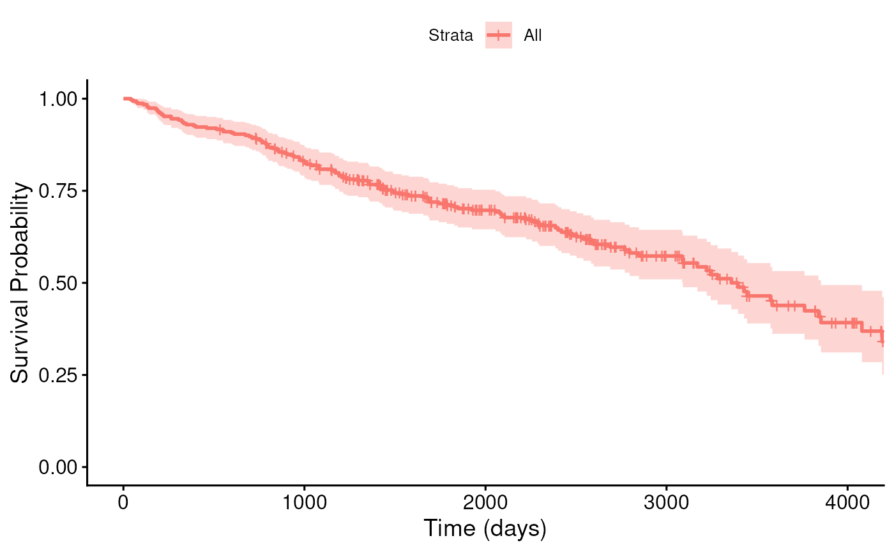
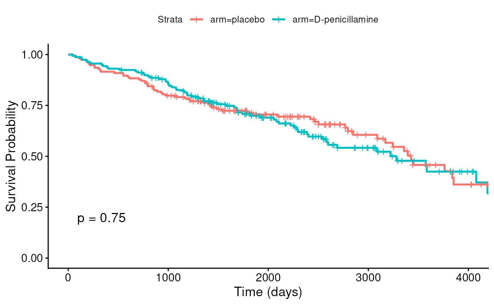
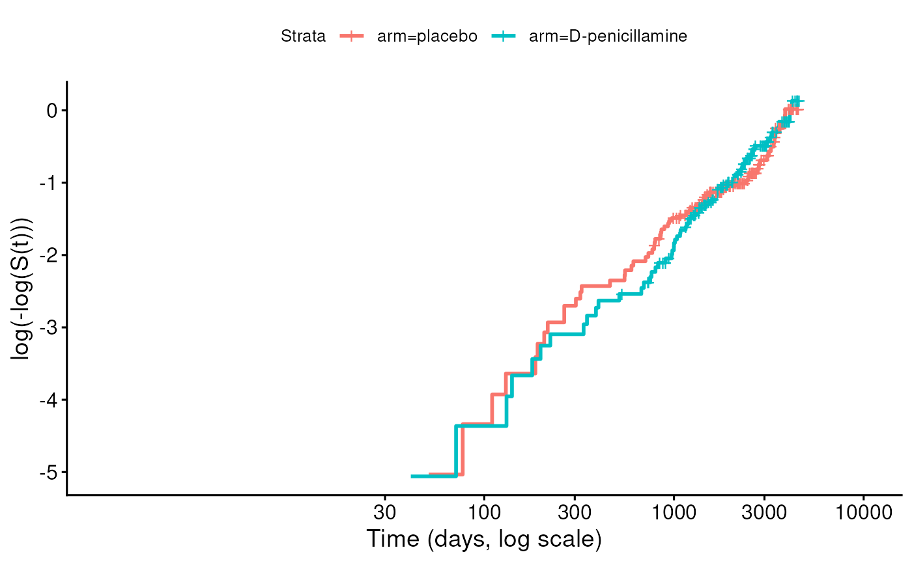

# Session 8 lab exercise: Survival Analysis part 3

**Learning objectives**

1.  Make stratified and unstratified Kaplan-Meier plots
2.  Perform Cox proportional hazards regression
3.  Assess the proportional hazards assumption
4.  Use residuals to check the fit of a Cox model
5.  Fit multivariable Cox models, perform tests for trend, and predict
    survival for specific covariate patterns

## Load the Primary Biliary Cirrhosis (pbc) dataset from the survival package

- Mayo Clinic trial in primary biliary cirrhosis (PBC) of the liver
  conducted between 1974 and 1984, $`n=418`$ patients.
- Randomized placebo controlled trial of the drug D-penicillamine.
  - 312 cases from RCT, plus additional 106 not from RCT.
- Primary outcome is (censored) time to death

\
[`library`](https://rdrr.io/r/base/library.html)`(`[`survival`](https://github.com/therneau/survival)`)`\
[`library`](https://rdrr.io/r/base/library.html)`(`[`survminer`](https://rpkgs.datanovia.com/survminer/index.html)`)`\
[`library`](https://rdrr.io/r/base/library.html)`(`[`tidyverse`](https://tidyverse.tidyverse.org)`)`\
[`data`](https://rdrr.io/r/utils/data.html)`(``pbc``)`\
[`summary`](https://rdrr.io/r/base/summary.html)`(``pbc``)`

    ##        id             time          status            trt       
    ##  Min.   :  1.0   Min.   :  41   Min.   :0.0000   Min.   :1.000  
    ##  1st Qu.:105.2   1st Qu.:1093   1st Qu.:0.0000   1st Qu.:1.000  
    ##  Median :209.5   Median :1730   Median :0.0000   Median :1.000  
    ##  Mean   :209.5   Mean   :1918   Mean   :0.8301   Mean   :1.494  
    ##  3rd Qu.:313.8   3rd Qu.:2614   3rd Qu.:2.0000   3rd Qu.:2.000  
    ##  Max.   :418.0   Max.   :4795   Max.   :2.0000   Max.   :2.000  
    ##                                                  NAs    :106    
    ##       age        sex        ascites            hepato          spiders      
    ##  Min.   :26.28   m: 44   Min.   :0.00000   Min.   :0.0000   Min.   :0.0000  
    ##  1st Qu.:42.83   f:374   1st Qu.:0.00000   1st Qu.:0.0000   1st Qu.:0.0000  
    ##  Median :51.00           Median :0.00000   Median :1.0000   Median :0.0000  
    ##  Mean   :50.74           Mean   :0.07692   Mean   :0.5128   Mean   :0.2885  
    ##  3rd Qu.:58.24           3rd Qu.:0.00000   3rd Qu.:1.0000   3rd Qu.:1.0000  
    ##  Max.   :78.44           Max.   :1.00000   Max.   :1.0000   Max.   :1.0000  
    ##                          NAs    :106       NAs    :106      NAs    :106     
    ##      edema             bili             chol           albumin     
    ##  Min.   :0.0000   Min.   : 0.300   Min.   : 120.0   Min.   :1.960  
    ##  1st Qu.:0.0000   1st Qu.: 0.800   1st Qu.: 249.5   1st Qu.:3.243  
    ##  Median :0.0000   Median : 1.400   Median : 309.5   Median :3.530  
    ##  Mean   :0.1005   Mean   : 3.221   Mean   : 369.5   Mean   :3.497  
    ##  3rd Qu.:0.0000   3rd Qu.: 3.400   3rd Qu.: 400.0   3rd Qu.:3.770  
    ##  Max.   :1.0000   Max.   :28.000   Max.   :1775.0   Max.   :4.640  
    ##                                    NAs    :134                     
    ##      copper          alk.phos            ast              trig       
    ##  Min.   :  4.00   Min.   :  289.0   Min.   : 26.35   Min.   : 33.00  
    ##  1st Qu.: 41.25   1st Qu.:  871.5   1st Qu.: 80.60   1st Qu.: 84.25  
    ##  Median : 73.00   Median : 1259.0   Median :114.70   Median :108.00  
    ##  Mean   : 97.65   Mean   : 1982.7   Mean   :122.56   Mean   :124.70  
    ##  3rd Qu.:123.00   3rd Qu.: 1980.0   3rd Qu.:151.90   3rd Qu.:151.00  
    ##  Max.   :588.00   Max.   :13862.4   Max.   :457.25   Max.   :598.00  
    ##  NAs    :108      NAs    :106       NAs    :106      NAs    :136     
    ##     platelet        protime          stage      
    ##  Min.   : 62.0   Min.   : 9.00   Min.   :1.000  
    ##  1st Qu.:188.5   1st Qu.:10.00   1st Qu.:2.000  
    ##  Median :251.0   Median :10.60   Median :3.000  
    ##  Mean   :257.0   Mean   :10.73   Mean   :3.024  
    ##  3rd Qu.:318.0   3rd Qu.:11.10   3rd Qu.:4.000  
    ##  Max.   :721.0   Max.   :18.00   Max.   :4.000  
    ##  NAs    :11      NAs    :2       NAs    :6

## Create a `Surv` object using variables “time” and “status”, add this to the pbc dataframe

`status` is coded 0 = censored (alive at end of study), 1 = liver
transplant, and 2 = dead. Patients who received transplants are removed
from risk of death, at least due to liver cirrhosis. Transplantation may
thus be related to risk, and not qualify as uninformative censoring. It
could actually be considered a “competing risk” because high-risk
patients may be prioritized for liver transplant (see the end of the
lecture). Instead, we will simply treat 0 and 1 as censored, and 2
(death) as an event.

We also keep only the 312 participants in the RCT, who have a
non-missing treatment assignment `trt` (1 = D-penicillamine, 2 =
placebo), and recode it as a factor with placebo as the reference group,
as in the lecture. `stage` and `edema` are converted to factors for
later use.

\
`pbc2`` ``<-`` ``pbc`` `[`%>%`](https://magrittr.tidyverse.org/reference/pipe.html)\
`  `[`filter`](https://dplyr.tidyverse.org/reference/filter.html)`(``!`[`is.na`](https://rdrr.io/r/base/NA.html)`(``trt``)``)`` `[`%>%`](https://magrittr.tidyverse.org/reference/pipe.html)\
`  `[`mutate`](https://dplyr.tidyverse.org/reference/mutate.html)`(``death ``=`` ``status`` ``==`` ``2``)`` `[`%>%`](https://magrittr.tidyverse.org/reference/pipe.html)\
`  `[`mutate`](https://dplyr.tidyverse.org/reference/mutate.html)`(``y ``=`` `[`Surv`](https://rdrr.io/pkg/survival/man/Surv.html)`(``time``, ``death``)``)`` `[`%>%`](https://magrittr.tidyverse.org/reference/pipe.html)\
`  `[`mutate`](https://dplyr.tidyverse.org/reference/mutate.html)`(``arm ``=`` `[`factor`](https://rdrr.io/r/base/factor.html)`(``trt``, levels ``=`` ``2``:``1``, labels ``=`` `[`c`](https://rdrr.io/r/base/c.html)`(``"placebo"``, ``"D-penicillamine"``)``)``,`\
`         stage ``=`` `[`factor`](https://rdrr.io/r/base/factor.html)`(``stage``)``,`\
`         edema ``=`` `[`factor`](https://rdrr.io/r/base/factor.html)`(``edema``)``)`\
[`table`](https://rdrr.io/r/base/table.html)`(``pbc2``$``arm``, ``pbc2``$``death``)`

    ##                  
    ##                   FALSE TRUE
    ##   placebo            94   60
    ##   D-penicillamine    93   65

## Plot a KM curve for all participants using `library(survminer)` function `ggsurvplot()`.

\
`fit`` ``<-`` `[`survfit`](https://rdrr.io/pkg/survival/man/survfit.html)`(``y`` ``~`` ``1``, data ``=`` ``pbc2``)`\
[`ggsurvplot`](https://rdrr.io/pkg/survminer/man/ggsurvplot.html)`(``fit``, xlab ``=`` ``"Time (days)"``, ylab ``=`` ``"Survival Probability"``)`

## Stratify by treatment and add a p-value to this plot (see `?ggsurvplot`).

\
`fit2`` ``<-`` `[`survfit`](https://rdrr.io/pkg/survival/man/survfit.html)`(``y`` ``~`` ``arm``, data ``=`` ``pbc2``)`\
[`ggsurvplot`](https://rdrr.io/pkg/survminer/man/ggsurvplot.html)`(``fit2``, pval ``=`` ``TRUE``, xlab ``=`` ``"Time (days)"``, ylab ``=`` ``"Survival Probability"``)`

## Check whether these p-values correspond to results from a log-rank test.

\
[`survdiff`](https://rdrr.io/pkg/survival/man/survdiff.html)`(``y`` ``~`` ``arm``, data ``=`` ``pbc2``)`

    ## Call:
    ## survdiff(formula = y ~ arm, data = pbc2)
    ## 
    ##                       N Observed Expected (O-E)^2/E (O-E)^2/V
    ## arm=placebo         154       60     61.8    0.0513     0.102
    ## arm=D-penicillamine 158       65     63.2    0.0502     0.102
    ## 
    ##  Chisq= 0.1  on 1 degrees of freedom, p= 0.7

## Perform a Cox proportional hazards regression, using the treatment arm as a predictor.

\
`fitcox`` ``<-`` `[`coxph`](https://rdrr.io/pkg/survival/man/coxph.html)`(``y`` ``~`` ``arm``, data ``=`` ``pbc2``)`\
[`summary`](https://rdrr.io/r/base/summary.html)`(``fitcox``)`

    ## Call:
    ## coxph(formula = y ~ arm, data = pbc2)
    ## 
    ##   n= 312, number of events= 125 
    ## 
    ##                       coef exp(coef) se(coef)     z Pr(>|z|)
    ## armD-penicillamine 0.05722   1.05889  0.17916 0.319    0.749
    ## 
    ##                    exp(coef) exp(-coef) lower .95 upper .95
    ## armD-penicillamine     1.059     0.9444    0.7453     1.504
    ## 
    ## Concordance= 0.499  (se = 0.025 )
    ## Likelihood ratio test= 0.1  on 1 df,   p=0.7
    ## Wald test            = 0.1  on 1 df,   p=0.7
    ## Score (logrank) test = 0.1  on 1 df,   p=0.7

## Create a log-minus-log plot to assess the proportional hazards assumption.

`fun = "cloglog"` plots $`\log(-\log(\hat S(t)))`$ against time on a log
scale. Under proportional hazards, the curves for the two arms should be
roughly parallel.

\
[`ggsurvplot`](https://rdrr.io/pkg/survminer/man/ggsurvplot.html)`(``fit2``, fun ``=`` ``"cloglog"``, xlab ``=`` ``"Time (days, log scale)"``)`

## Plot Schoenfeld residuals and perform Schoenfeld test for the above Cox model

\
`fitzph`` ``<-`` `[`cox.zph`](https://rdrr.io/pkg/survival/man/cox.zph.html)`(``fitcox``)`\
[`plot`](https://rdrr.io/r/graphics/plot.default.html)`(``fitzph``)`

\
`fitzph`

    ##        chisq df    p
    ## arm    0.612  1 0.43
    ## GLOBAL 0.612  1 0.43

## Exercises

### Exercise 1: Martingale and deviance residuals

Fit the Cox model `coxph(y ~ age + edema + arm, data = pbc2)`. As in the
lecture, plot its Martingale residuals
(`residuals(..., type = "martingale")`) and deviance residuals
(`residuals(..., type = "deviance")`) against follow-up time, with a
horizontal line at zero and a smoother, for example with
[`ggplot()`](https://ggplot2.tidyverse.org/reference/ggplot.html),
[`geom_point()`](https://ggplot2.tidyverse.org/reference/geom_point.html),
[`geom_hline()`](https://ggplot2.tidyverse.org/reference/geom_abline.html),
and
[`geom_smooth()`](https://ggplot2.tidyverse.org/reference/geom_smooth.html).

1.  What is the largest possible value of a Martingale residual, and
    why? Which of the two types of residual is more symmetrically
    distributed about zero?
2.  Find the 5 patients with the largest absolute deviance residuals,
    and look at their `time`, `death`, `age`, `edema`, and `arm`. Why
    does the model predict these patients poorly?

### Exercise 2: Test for trend across stage

Fit a Cox model with histologic `stage` as an unordered factor, then
refit it with `stage` as an ordered factor
(`factor(stage, ordered = TRUE)`), as in the lecture. In the ordered
model, the `.L`, `.Q`, and `.C` terms are the linear, quadratic, and
cubic trends across the four stages. Is there evidence for a linear
trend in the log hazard across stage? For a non-linear trend?

### Exercise 3: Multivariable model and predicted survival

Fit a multivariable Cox model
`coxph(y ~ age + edema + stage + arm, data = pbc2)` and report the
adjusted hazard ratios with 95% confidence intervals. Check the
proportional hazards assumption for every term with
[`cox.zph()`](https://rdrr.io/pkg/survival/man/cox.zph.html); does any
term appear to violate it? Finally, predict and plot survival curves for
two patients who are both 50 years old, with no edema, and in the
placebo arm: one in stage 1 and one in stage 4.

*Hint*: Create the covariate patterns with a `data.frame` whose factor
levels match the data, then pass it to
[`survfit()`](https://rdrr.io/pkg/survival/man/survfit.html):

\
`newpatients`` ``<-`` `[`data.frame`](https://rdrr.io/r/base/data.frame.html)`(`\
`  age ``=`` `[`c`](https://rdrr.io/r/base/c.html)`(``50``, ``50``)``,`\
`  edema ``=`` `[`factor`](https://rdrr.io/r/base/factor.html)`(`[`c`](https://rdrr.io/r/base/c.html)`(``"0"``, ``"0"``)``, levels ``=`` `[`levels`](https://rdrr.io/r/base/levels.html)`(``pbc2``$``edema``)``)``,`\
`  stage ``=`` `[`factor`](https://rdrr.io/r/base/factor.html)`(`[`c`](https://rdrr.io/r/base/c.html)`(``"1"``, ``"4"``)``, levels ``=`` `[`levels`](https://rdrr.io/r/base/levels.html)`(``pbc2``$``stage``)``)``,`\
`  arm ``=`` `[`factor`](https://rdrr.io/r/base/factor.html)`(`[`c`](https://rdrr.io/r/base/c.html)`(``"placebo"``, ``"placebo"``)``, levels ``=`` `[`levels`](https://rdrr.io/r/base/levels.html)`(``pbc2``$``arm``)``)`\
`)`\
`predfit`` ``<-`` `[`survfit`](https://rdrr.io/pkg/survival/man/survfit.html)`(``fitmulti``, newdata ``=`` ``newpatients``)`\
[`ggsurvplot`](https://rdrr.io/pkg/survminer/man/ggsurvplot.html)`(``predfit``, data ``=`` ``newpatients``, legend.labs ``=`` `[`c`](https://rdrr.io/r/base/c.html)`(``"Stage 1"``, ``"Stage 4"``)``)`
